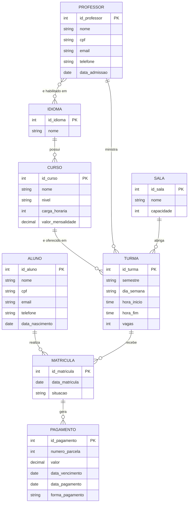

# 2. Diagrama Entidade-Relacionamento (conceitual)

## Cardinalidades
| Relacionamento | Cardinalidade |
|---|---|
| Idioma - Curso | 1:N (um idioma tem N cursos; um curso, 1 idioma) |
| Curso - Turma | 1:N |
| Professor - Turma | 1:N |
| Sala - Turma | 1:N |
| Professor - Idioma | N:N (vira a tabela professor_idioma) |
| Aluno - Turma | N:N, resolvido pela entidade Matrícula |
| Aluno - Matrícula / Turma - Matrícula | 1:N cada |
| Matrícula - Pagamento | 1:N |
