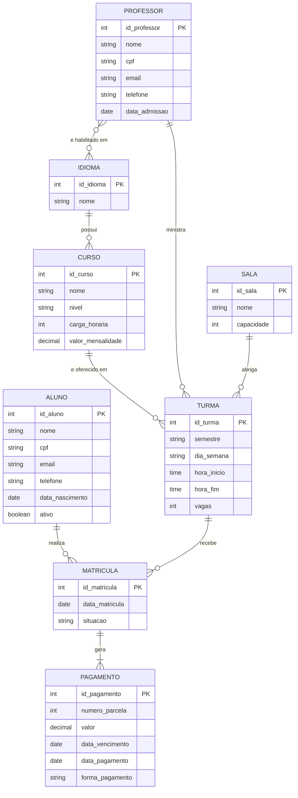

# 2. Diagrama Entidade-Relacionamento (conceitual)

O diagrama editável está no `diagramas/escola-idiomas.drawio`, na página **DER**.
Esta versão é conceitual: não tem chaves estrangeiras, que pertencem ao modelo relacional.

## Cardinalidades
| Relacionamento | Cardinalidade |
|---|---|
| Idioma – Curso | 1:N (um idioma tem N cursos; um curso pertence a 1 idioma) |
| Curso – Turma | 1:N |
| Professor – Turma | 1:N |
| Sala – Turma | 1:N |
| Professor – Idioma | N:N (0..* de cada lado; vira a tabela `professor_idioma` no modelo relacional) |
| Aluno – Matrícula | 1:N |
| Turma – Matrícula | 1:N |
| Matrícula – Pagamento | 1:N (cada matrícula gera de 1 a N parcelas) |

O relacionamento N:N entre Aluno e Turma é resolvido pela entidade Matrícula.

## Regras de negócio que não cabem na cardinalidade
- Um professor só pode ministrar turma de um idioma em que esteja habilitado.
- Duas turmas não podem usar a mesma sala no mesmo dia e horário de início.
- As vagas de uma turma não podem exceder a capacidade da sala.
- Uma habilitação em uso por turma não pode ser removida.

No modelo lógico, essas regras são garantidas no banco por CHECK, UNIQUE e TRIGGER
(ver `src/sql/ddl/10_alter.sql` e `src/sql/ddl/11_triggers.sql`).
