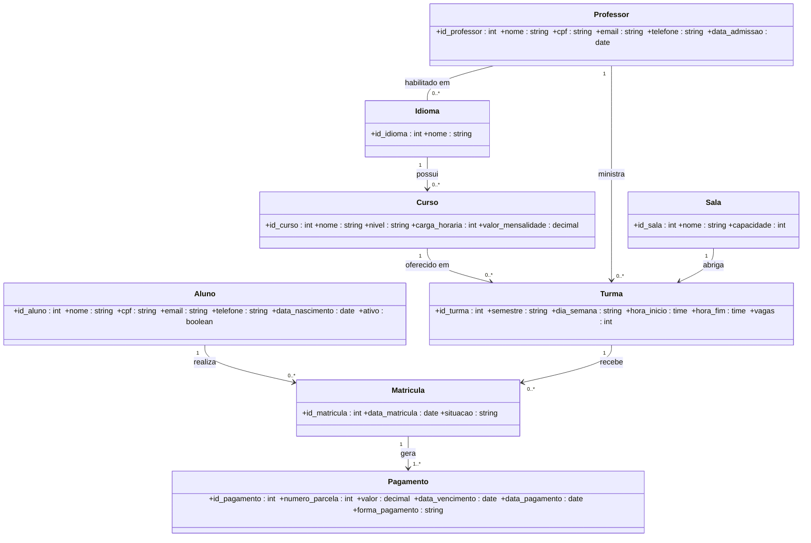

# 4. DER em notação alternativa (UML - diagrama de classes)

O diagrama editável está em `diagramas/escola-idiomas.drawio`, na página **DER UML**.
Como em UML a ligação entre classes já é a associação, não há chaves estrangeiras nem classe associativa:
a N:N entre Professor e Idioma é uma associação direta com multiplicidade 0..* dos dois lados.

As multiplicidades são as mesmas do DER conceitual (`docs/02-der.md`).
